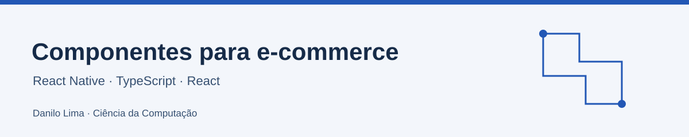
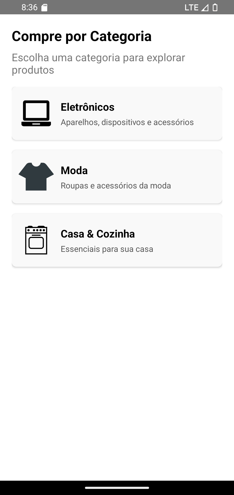

# Componentes para e-commerce

Biblioteca de componentes React Native desenvolvida no contexto do meu TCC em Ciência da Computação na UFES. O foco é separar apresentação, dados e ações para reutilizar os mesmos elementos em diferentes telas.

**TCC · Ciência da Computação · UFES**

React Native · TypeScript · React

[English](README.en.md) · [Meu percurso em Ciência da Computação](https://github.com/Danilo-Js/My-Computer-Science-Course)

<p align="center"></p>

## O que este projeto explora

- Contratos de propriedades tipados e callbacks para integrar comportamento.
- Componentes para catálogo, busca, carrinho, entrega e fluxos demonstrativos de checkout.
- Personalização de estilos e textos em português e inglês.

## Como explorar

| Caminho | Conteúdo |
|---|---|
| [Exportações da biblioteca](src/index.tsx) | `src/index.tsx` |
| [Implementação dos componentes](src/components) | `src/components` |
| [Guia de uso em português](Docs/Portuguese/Usage) | `Docs/Portuguese/Usage` |
| [Usage reference in English](Docs/English/Usage) | `Docs/English/Usage` |
| [Exemplos por componente](UsageExamples) | `UsageExamples` |
| [Diagramas e organização](Docs/Portuguese/Diagrams.md) | `Docs/Portuguese/Diagrams.md` |

## Executar ou consultar

```bash
npm install react-native-ecommerce-components
```

Instale em um projeto React Native já configurado. A biblioteca depende dos pares React/React Native e de `react-native-responsive-screen`, conforme [package.json](package.json). Consulte o guia do componente para verificar suas propriedades antes de integrar.

### Exemplo mínimo

```tsx
import { ProductList } from 'react-native-ecommerce-components';

<ProductList
  products={[{ id: 'demo-1', title: 'Produto demonstrativo', price: 99.9, image: 'https://placehold.co/300x300/png' }]}
  onProductPress={product => console.log(product.id)}
  onAddToCart={product => console.log(product.id)}
  language="pt"
/>
```

## Componentes

| Catálogo e busca | Compra e entrega | Conta e relacionamento |
|---|---|---|
| CategoryList · ProductList · ProductDetail · SearchBar | ShoppingCart · OrderSummary · CouponCodeInput · ShippingDetails · PaymentGateway · OrderConfirmation · OrderTracking | NewClient · WishList · ReviewAndRatings |

[Documentação em português](Docs/Portuguese/Usage) · [English API reference](Docs/English/Usage) · [Aplicativo demonstrativo](https://github.com/Danilo-Js/TechEcommerce)

| Componente | Referência |
|---|---|
| `CategoryList` | [Português](Docs/Portuguese/Usage/CategoryList.md) · [English](Docs/English/Usage/CategoryList.md) |
| `ProductList` | [Português](Docs/Portuguese/Usage/ProductList.md) · [English](Docs/English/Usage/ProductList.md) |
| `ProductDetail` | [Português](Docs/Portuguese/Usage/ProductDetail.md) · [English](Docs/English/Usage/ProductDetail.md) |
| `SearchBar` | [Português](Docs/Portuguese/Usage/SearchBar.md) · [English](Docs/English/Usage/SearchBar.md) |
| `ShoppingCart` | [Português](Docs/Portuguese/Usage/ShoppingCart.md) · [English](Docs/English/Usage/ShoppingCart.md) |
| `OrderSummary` | [Português](Docs/Portuguese/Usage/OrderSummary.md) · [English](Docs/English/Usage/OrderSummary.md) |
| `CouponCodeInput` | [Português](Docs/Portuguese/Usage/CouponCodeInput.md) · [English](Docs/English/Usage/CouponCodeInput.md) |
| `ShippingDetails` | [Português](Docs/Portuguese/Usage/ShippingDetails.md) · [English](Docs/English/Usage/ShippingDetails.md) |
| `PaymentGateway` | [Português](Docs/Portuguese/Usage/PaymentGateway.md) · [English](Docs/English/Usage/PaymentGateway.md) |
| `OrderConfirmation` | [Português](Docs/Portuguese/Usage/OrderConfirmation.md) · [English](Docs/English/Usage/OrderConfirmation.md) |
| `OrderTracking` | [Português](Docs/Portuguese/Usage/OrderTracking.md) · [English](Docs/English/Usage/OrderTracking.md) |
| `NewClient` | [Português](Docs/Portuguese/Usage/NewClient.md) · [English](Docs/English/Usage/NewClient.md) |
| `WishList` | [Português](Docs/Portuguese/Usage/WishList.md) · [English](Docs/English/Usage/WishList.md) |
| `ReviewAndRatings` | [Português](Docs/Portuguese/Usage/ReviewAndRatings.md) · [English](Docs/English/Usage/ReviewAndRatings.md) |

## Conceitos e contexto

Os componentes de pagamento representam interface e coleta de dados. A biblioteca não é, por si só, um gateway, adquirente, serviço antifraude ou backend de comércio eletrônico.

## Autoria e procedência

Danilo José Lima de Oliveira. O contexto acadêmico e os diagramas estão documentados no acervo do projeto.

## Licença

Os termos deste acervo estão em [LICENSE](LICENSE). Os projetos e materiais vinculados conservam suas próprias condições e atribuições.

## Projetos relacionados

- [TechEcommerce](https://github.com/Danilo-Js/TechEcommerce)
